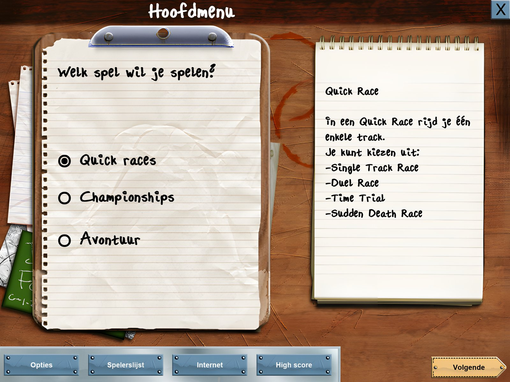
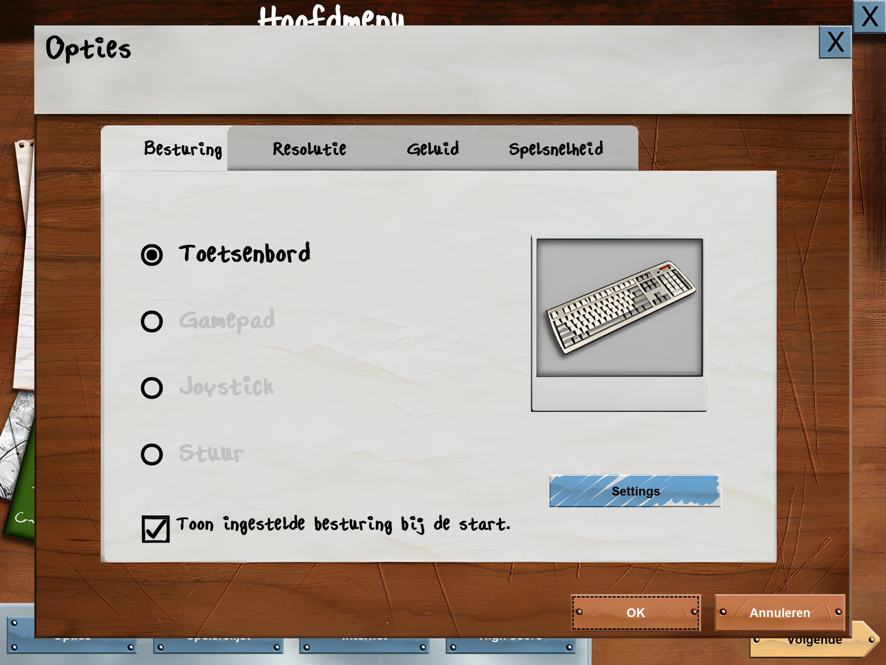

# 🏖️ Europe Racer Revived 🚘

**Davilex' Europe Racer (2001, in Nederland "Europe Racing"), herboren als echte Mac-app voor Apple Silicon. In HD, met een menu in 4K.**

    

> [!IMPORTANT]
> **De game zelf zit niet in deze repo, alleen de port.** Je hebt twee downloads van [MyAbandonware](https://www.myabandonware.com/game/europe-racing-gsh) nodig: de ISO-versie (`Europe-Racing_Win_EN-FR-DE-ES-IT-NL_ISO-Version.zip`) voor de spelbestanden en de officiële NoCD van Davilex (`Europe-Racing_NoCD_Win_EN-FR-DE-ES-IT-NL.zip`, 15 juni 2002). Die NoCD is de laatste versie van de game (Patch 3) zonder SafeDisc-beveiliging; de port is daarop gebouwd.

> [!WARNING]
> **Nog in ontwikkeling.** Er is nog geen `setup.sh`, zoals bij [A2 Racer IV Revived](https://github.com/DvT093/A2RacerIV-Revived) en [Vakantie Racer Revived](https://github.com/DvT093/VakantieRacer-Revived). Zelf bouwen kan nu alleen met een eigen Ghidra-export van de exe (zie "Bouwen").



*English below.*

## ✨ Wat is er nieuw

| | |
|---|---|
| 🍎 **Native op de Mac** | Geen Wine, geen emulator. De spelcode wordt omgezet naar een echte Apple Silicon-app |
| 🎨 **HD-textures** | Textures 4x opgeschaald met AI. Druk **F9** om live te wisselen met het origineel |
| 🖥️ **Menu in 4K** | Het menu is opnieuw gebouwd en tekent elk plaatje en elke tekst scherp op je Retina-scherm, ook F9 wisselt daar |
| 🔍 **Scherp beeld** | Rendert in 4:3 op de maat van je scherm, met 4x anti-aliasing en 16x filtering |
| 🔊 **Geluid** | Het Miles Sound System van de game, nagebouwd voor de Mac, met de mp3-muziek |
| 🎮 **60 fps** | Vast op 60 |

## 📸 Screenshots

**Opties, in 4K:**



## 💿 Over deze repo

In deze repo zitten **geen spelbestanden**: geen ISO, geen exe, geen plaatjes of geluid. Het menu en de race lezen alles bij het starten uit de CD-bestanden die je zelf neerzet.

## 🧰 Wat je nodig hebt
- Een Mac met Apple Silicon (M1 of nieuwer)
- De twee zips van MyAbandonware (zie boven)
- [Homebrew](https://brew.sh) met `cmake ninja pkgconf sdl3 ffmpeg freetype glslang spirv-cross llvm@22 pillow`
- Voor nu nog: [Ghidra](https://ghidra-sre.org) om de exe te analyseren

## 🛠️ Bouwen

De repo bouwt naast twee andere repo's, in dezelfde map:

```sh
git clone https://github.com/DvT093/EuropeRacer-Revived.git "Europe Racer"
git clone https://github.com/DvT093/Davilex-RED.git
git clone -b er https://github.com/DvT093/SwARc.git SwARc-er
```

Daarna, in `Europe Racer`:
1. Zet de inhoud van de CD (uit de ISO-zip) in `iso/`, zodat `iso/EuropeRacer/` bestaat, en de `spel.exe` uit de NoCD-zip in `dl/nocd/`.
2. Maak met Ghidra de symbolen in `symbols/` (`ExportFunctions.java` en `ExportJumpTables.java` uit SwARc `tools/ghidra`).
3. `cmake --preset release`, `./lift.sh`, dan `cmake --build --preset release --target eracer eracer-menu`.
4. Starten: `out/build/release/eracer-menu --game-dir iso/EuropeRacer`.

HD: download `europeracer-hd-v1.zip` bij de [release hd-v1](https://github.com/DvT093/EuropeRacer-Revived/releases/tag/hd-v1) en pak hem uit in `Europe Racer` (`unzip -o europeracer-hd-v1.zip`). Zelf maken kan ook: `tools/make_texture_pack.py` (race) en `tools/upscale_menu.py` (menu), allebei met Real-ESRGAN. Het menu gebruikt de HD-plaatjes met `--mods mods/menu`.

## Toetsen in de race

| Toets | Wat het doet |
|---|---|
| Pijltjes | Sturen, gas, remmen |
| Esc | Pauze, met de vraag of je wilt stoppen |
| F9 | Origineel of HD (in de race en in het menu) |
| F10 / F11 | Alleen anti-aliasing / alleen filtering |

## ⚠️ Bekende problemen
- **Toetsen instellen** in Opties doet nog niets.
- **Alleen Nederlands.** De CD heeft zes talen; kiezen kan nog niet.
- **Doppler en geluidsfilters** van Miles doen niets.
- **Internet** in het menu toont alleen de vraag: de Davilex-site bestaat niet meer.

## Credits en licentie
- Gebouwd op [SwARc](https://github.com/JTM-rootstorm/x86recomp) van JT (MIT), een static recompiler voor x86-games.
- Het menu draait op de gedeelde engine van [Davilex-RED](https://github.com/DvT093/Davilex-RED), samen met [Vakantie Racer Revived](https://github.com/DvT093/VakantieRacer-Revived) en [A2 Racer IV Revived](https://github.com/DvT093/A2RacerIV-Revived).
- De code in deze repo is MIT (zie `LICENSE`).
- Europe Racer is van Davilex en blijft van de rechthebbende. Deze repo bevat geen spelbestanden; de HD-plaatjes worden gemaakt uit de originele en zijn alleen bedoeld voor wie de game zelf heeft. Dit project heeft niets met Davilex te maken.

---

# 🏖️ Europe Racer Revived 🚘 (English)

Davilex' Europe Racer (2001, a Dutch racing game, released in the Netherlands as "Europe Racing") reborn as a native Apple Silicon Mac app: AI-upscaled HD textures (F9 toggles the original live), a rebuilt menu that is sharp in 4K, the game's Miles sound rebuilt for the Mac, and a locked 60 fps. Screenshots above.

No Wine, no emulator: the game code is recompiled into a real Mac app.

> [!IMPORTANT]
> **The game itself is not in this repo, only the port.** You need two downloads from [MyAbandonware](https://www.myabandonware.com/game/europe-racing-gsh): the ISO version (`Europe-Racing_Win_EN-FR-DE-ES-IT-NL_ISO-Version.zip`) for the game files, and Davilex' official NoCD (`Europe-Racing_NoCD_Win_EN-FR-DE-ES-IT-NL.zip`, 15 June 2002). That NoCD is the last version of the game (Patch 3) without SafeDisc protection; the port is built on it.

> [!WARNING]
> **Work in progress.** There is no `setup.sh` yet, unlike [A2 Racer IV Revived](https://github.com/DvT093/A2RacerIV-Revived) and [Vakantie Racer Revived](https://github.com/DvT093/VakantieRacer-Revived). Building it yourself currently needs your own Ghidra export of the exe (see "Build").

This repo contains **no game files**: no ISO, no exe, no pictures or sound. The menu and the race read everything at startup from the CD files you put in place.

## 🧰 What you need
- A Mac with Apple Silicon (M1 or newer)
- The two zips from MyAbandonware (see above)
- [Homebrew](https://brew.sh) with `cmake ninja pkgconf sdl3 ffmpeg freetype glslang spirv-cross llvm@22 pillow`
- For now: [Ghidra](https://ghidra-sre.org) to analyse the exe

## 🛠️ Build

The repo builds next to two other repos, in the same folder:

```sh
git clone https://github.com/DvT093/EuropeRacer-Revived.git "Europe Racer"
git clone https://github.com/DvT093/Davilex-RED.git
git clone -b er https://github.com/DvT093/SwARc.git SwARc-er
```

Then, in `Europe Racer`:
1. Put the CD contents (from the ISO zip) in `iso/`, so that `iso/EuropeRacer/` exists, and the `spel.exe` from the NoCD zip in `dl/nocd/`.
2. Create the symbols in `symbols/` with Ghidra (`ExportFunctions.java` and `ExportJumpTables.java` from SwARc `tools/ghidra`).
3. `cmake --preset release`, `./lift.sh`, then `cmake --build --preset release --target eracer eracer-menu`.
4. Run: `out/build/release/eracer-menu --game-dir iso/EuropeRacer`.

HD: download `europeracer-hd-v1.zip` from the [hd-v1 release](https://github.com/DvT093/EuropeRacer-Revived/releases/tag/hd-v1) and unzip it in `Europe Racer` (`unzip -o europeracer-hd-v1.zip`). To make it yourself: `tools/make_texture_pack.py` (race) and `tools/upscale_menu.py` (menu), both with Real-ESRGAN. The menu uses the HD pictures with `--mods mods/menu`.

## Keys in the race
Arrows steer and drive, **Esc** = pause with the question whether to quit, **F9** = original or HD, **F10/F11** = anti-aliasing / filtering only.

## ⚠️ Known issues
- **Key setup** under Options does nothing yet.
- **Dutch only.** The CD has six languages; choosing one is not possible yet.
- **Doppler and sound filters** from Miles do nothing.
- **Internet** in the menu only shows the question: the Davilex site no longer exists.

## Credits and license
Built on [SwARc](https://github.com/JTM-rootstorm/x86recomp) by JT (MIT). The menu runs on the shared engine of [Davilex-RED](https://github.com/DvT093/Davilex-RED), together with [Vakantie Racer Revived](https://github.com/DvT093/VakantieRacer-Revived) and [A2 Racer IV Revived](https://github.com/DvT093/A2RacerIV-Revived). The code in this repo is MIT (see `LICENSE`). Europe Racer belongs to Davilex and its rights holder; this repo contains no game files, and the HD pictures are made from the originals and meant only for people who own the game. This project is not affiliated with Davilex.
